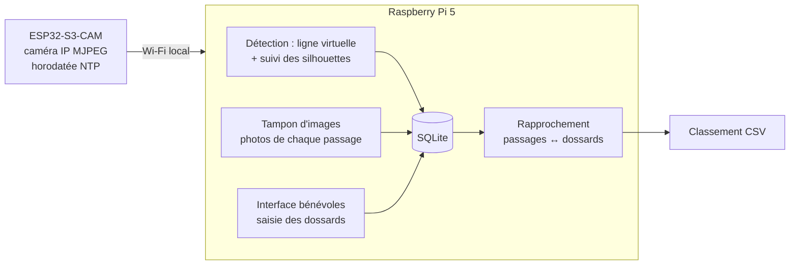

# Chrono d'arrivée — ESP32-S3-CAM + Raspberry Pi

Comptage et chronométrage des coureurs à la ligne d'arrivée, pensé pour une course
locale (Automnales de Saint-Pierre-des-Landes) : arrivées en paquets jusqu'à 5,
couloir de 5 m, classement avec temps par dossard.



**Principe** : la caméra donne les **temps** (et une photo de chaque passage), le
bénévole donne l'**ordre des dossards**. Le Pi aligne les deux et signale chaque
écart au lieu de deviner : « 2 passages sans dossard », « dossard 41 sans temps »…
Les photos servent d'arbitre.

| Dossier | Contenu |
|---|---|
| [`firmware/`](firmware) | Firmware PlatformIO de la caméra (flux MJPEG authentifié, horodatage NTP) |
| [`pi/`](pi) | Service Python : capture, détection, base, API et interface web |
| [`pi/tools/fake_camera.py`](pi/tools/fake_camera.py) | Fausse caméra (scène simulée) pour tout tester sans matériel |
| [`docs/`](docs) | [Matériel et installation sur le terrain](docs/materiel.md), [installation du Pi](docs/installation-pi.md) |

## Démarrage rapide (sans matériel)

```bash
cd pi
python3 -m venv .venv && . .venv/bin/activate
pip install -r requirements-dev.txt
python -m pytest                       # 36 tests : détection, rapprochement, API

cp config.example.toml config.toml
# dans config.toml : stream_url = "http://127.0.0.1:8081/stream", token = "essai123",
#                    volunteer_token = "benevole1", host = "127.0.0.1"
python tools/fake_camera.py --token essai123 &
python -m finishline --config config.toml
# → http://127.0.0.1:8000, code « benevole1 », onglet Course : créer, donner le départ
```

## Firmware de la caméra

```bash
cd firmware
cp include/secrets.example.h include/secrets.h   # Wi-Fi du Pi, serveur NTP, jeton
pio run -e s3eye -t upload -t monitor             # ou -e xiao pour une XIAO ESP32S3 Sense
```

`s3eye` couvre le brochage ESP32-S3-EYE, utilisé par la plupart des cartes
« ESP32-S3-CAM » (Freenove, Keyestudio, clones). En cas de boucle de démarrage
sur PSRAM, voir le commentaire `memory_type` dans [`platformio.ini`](firmware/platformio.ini).

## Le jour de la course

1. **Avant** : Pi et caméra sous tension (secteur, batterie solaire en secours),
   onglet **Réglage** : vérifier « Caméra OK », décalage d'horloge < 100 ms, bande
   orange sur la ligne peinte. Faire passer un bénévole pour vérifier le cadre vert.
2. **Départ** : onglet **Course** → « Donner le départ maintenant » (ou corriger l'heure ensuite).
3. **Arrivées** : un bénévole tape les dossards **dans l'ordre d'arrivée** sur le
   pavé numérique. Le compteur « dossards à saisir » indique le retard, normal
   pendant un paquet.
4. **Contrôle** : corriger les alertes (▲▼ pour réordonner, ±1 sur un passage,
   « Faux positif », « Passage manuel »), en s'aidant des photos.
5. **Fin** : clôturer, télécharger le CSV (place, dossard, nom, temps arrondi à la
   seconde supérieure, temps brut au 1/10).

## Limites connues et mesurées

Les tests rejouent une scène simulée (vue du dessus, 640×480 pour 5 m) : isolés,
duo épaule contre épaule, paquet de 5 sur toute la largeur, coureur lent, nuage.

- **Cadence** : comptage exact à **≥ 12 i/s** pour des coureurs à 4 m/s ; à 10 i/s
  des coureurs passent entre deux images. Viser 15–20 i/s (VGA, qualité JPEG 12).
- **Contraste** : la bande doit être posée **sur la ligne peinte** (blanc). Sur bitume
  nu, un maillot gris se confond avec le sol.
- **Coureurs collés** : séparés par la largeur des silhouettes (calibrage
  `runner_width_px`) ; c'est l'estimation la plus fragile, d'où le rapprochement
  avec les dossards et les photos.
- **Vue plongeante obligatoire** (≈ 4 m de haut, voir [docs/materiel.md](docs/materiel.md)).
  En vue de côté, les coureurs se masquent.

## Sécurité et données personnelles

- Réseau Wi-Fi dédié émis par le Pi (WPA2, mot de passe fort), sans accès Internet.
- Caméra : chaque requête exige un jeton (`Authorization: Bearer`, comparaison en
  temps constant), réglages capteur en liste blanche.
- Interface : code bénévole obligatoire, en-têtes CSP stricts, aucun contenu
  inséré en HTML (XSS), noms de fichiers d'images validés (pas de traversée de
  répertoire), requêtes SQL paramétrées.
- **RGPD** : filmer des participants impose de les **informer** (règlement de la
  course, affichage à l'arrivée), de **limiter la conservation** des images (effacer
  `data/course_*/` après la publication des résultats) et de ne pas publier de
  photos sans accord.

## Sobriété

Le firmware ne fait que capturer ; le Pi décode les JPEG en résolution réduite
(décodage DCT natif) et n'analyse qu'une bande de 14 lignes : environ 10 W au total.
L'enregistrement intégral est désactivé par défaut ; seules ~1,5 s d'images
autour de chaque passage sont conservées.
